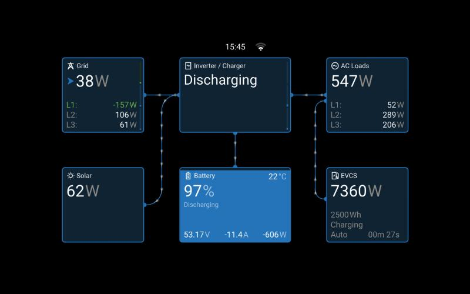
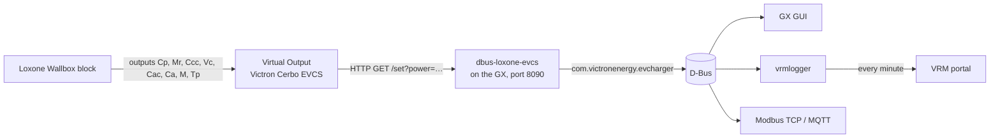
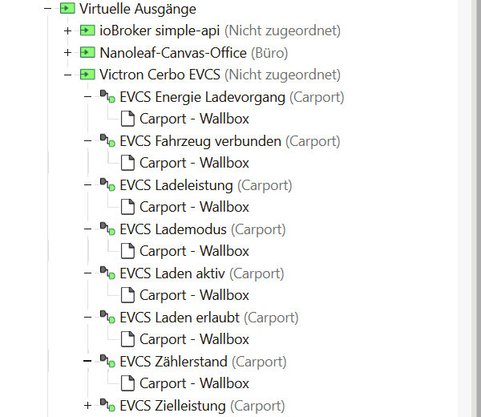
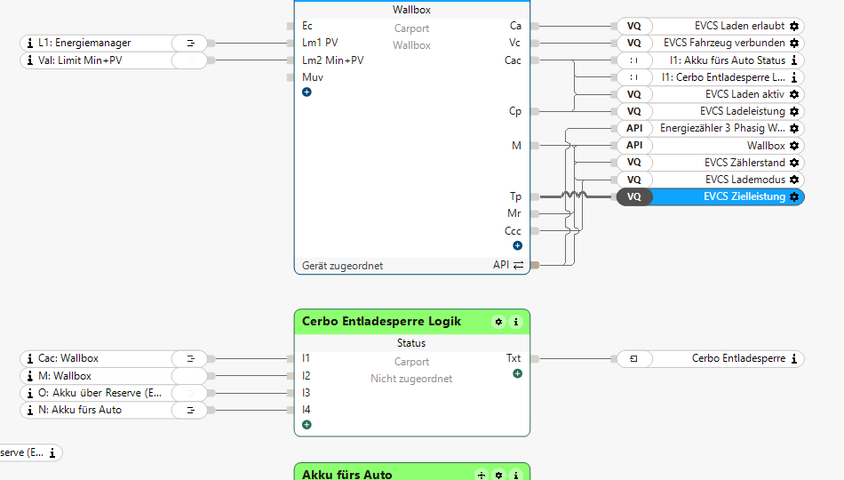

# dbus-loxone-evcs

Venus OS driver that publishes a **Loxone Wallbox** as a Victron **EV Charging Station** on a Cerbo GX (or any GX device). The GX GUI, the VRM portal and the GX Modbus TCP server then treat it like a native Victron EVCS.



*GX overview while charging (test values pushed with curl): power, session energy, status, mode and charging time come from Loxone.*

## How the data gets to VRM



1. **Loxone pushes.** A Virtual Output with one HTTP command per value sends every change of the Wallbox block outputs to the GX. Each command repeats a non-zero value every 5 minutes, so the driver catches up after a restart without waiting for the next change. Loxone never repeats a 0 (see [Zero values](#zero-values)).
2. **The driver translates.** `dbus-loxone-evcs` listens on port 8090, keeps the latest values, persists them in `state.json`, and publishes them on D-Bus as `com.victronenergy.evcharger.loxone_<instance>`.
3. **The GX does the rest.** Everything on D-Bus with the `evcharger` service type is shown in the GX GUI, logged by `vrmlogger` and uploaded to VRM with the normal log interval (Settings → VRM online portal). Nothing has to be configured in VRM itself. The charger shows up as an EVCS widget on the VRM dashboard and in the device list.

**Keep the VRM history.** VRM identifies a device by its device instance. If this driver replaces another EVCS driver, set `DeviceInstance` in `config.ini` to the instance of the old one (here: 43, from the former `dbus-evcc` driver) and the history continues.

## D-Bus paths

| Path | Source (Loxone Wallbox output) | Note |
|---|---|---|
| `/Ac/Power` | `Cp` Current charging power | kW → W |
| `/Ac/L1..L3/Power` | `Cp` | split evenly over `Phases`; Loxone has no per-phase values |
| `/Ac/Energy/Forward` | `Ccc` Consumption current charge | or `Mr` meter reading with `EnergySource = meter` |
| `/Session/Energy` | `Ccc` | read by the gui-v2 overview tile |
| `/ChargingTime`, `/Session/Time` | derived | seconds with `Cac` = 1 since the vehicle was plugged in |
| `/Status` | `Vc`, `Cac`, `Ca`, `M`, `Ccc` | 0 disconnected, 1 connected, 2 charging, 3 charged, 4 waiting for sun, 6 waiting for start |
| `/Mode` | `M` Current charging mode | modes in `AutoModes` → 1 Auto, others → 0 Manual |
| `/StartStop` | `Ca` Charging allowed | |
| `/Current` | `Cp` | derived from power, voltage and phases |
| `/SetCurrent` | `Tp` Target charging power | derived from power, voltage and phases |

All paths are read-only. Changing mode or current in the GX GUI or VRM has no effect; the Loxone Wallbox block stays in charge.

## Install on the GX

The repo is checked out directly on the GX and the driver runs from that checkout. Everything below runs on the GX as root: enable SSH (Settings → General → Access level "Superuser", set a root password or add an SSH key), then `ssh root@<gx-ip>`.

### 1. Install git

Venus OS has no git by default, but it is in the Victron package feed:

```bash
opkg update
opkg install git
```

opkg installs into the root filesystem, which a firmware update replaces. The checkout in `/data` and the driver survive the update; only git is gone, so run `opkg install git` again before the next `git pull`. If `opkg install` complains about a read-only filesystem, run `/opt/victronenergy/swupdate-scripts/remount-rw.sh` first.

### 2. Clone and install

```bash
git clone https://github.com/bate/dbus-loxone-evcs.git /data/dbus-loxone-evcs
cd /data/dbus-loxone-evcs
sh install.sh
```

`install.sh` creates `config.ini` from the sample if it does not exist, links the service into `/service` (daemontools starts it within seconds) and adds itself to `/data/rc.local`, so the driver comes back after a firmware update.

### 3. Configure

Edit `config.ini` (the comments in `config.sample.ini` explain every setting), then restart:

```bash
vi /data/dbus-loxone-evcs/config.ini
/data/dbus-loxone-evcs/restart.sh
```

`config.ini`, `state.json` and `current.log` are in `.gitignore`, so they stay untouched by `git pull`.

### 4. Check

```bash
svstat /service/dbus-loxone-evcs
tail /data/dbus-loxone-evcs/current.log
curl http://localhost:8090/state
```

### Update

```bash
cd /data/dbus-loxone-evcs
git pull
./restart.sh
```

### Without git

If you would rather not install git, download the same files as a tarball. Running it again later updates the code and keeps `config.ini` and `state.json`:

```bash
mkdir -p /data/dbus-loxone-evcs
cd /data/dbus-loxone-evcs
curl -fsSL https://github.com/bate/dbus-loxone-evcs/archive/refs/heads/main.tar.gz | tar xz --strip-components=1
sh install.sh
```

### Replacing another EVCS driver

If another EVCS driver used the same device instance, remove its line from `/data/rc.local` and stop it first (`svc -d /service/<name>`; if its `run` script starts python without `exec`, also kill the python process).

### Uninstall

```bash
/data/dbus-loxone-evcs/uninstall.sh
rm -rf /data/dbus-loxone-evcs
```

## Loxone setup

In Loxone Config, under the Miniserver → *Virtual Outputs*, add a Virtual Output:

| Property | Value |
|---|---|
| Name | `Victron Cerbo EVCS` |
| Address | `http://<gx-ip>:8090` |
| Close connection after sending | on |

Add one **Virtual Output Command** per value. For every command: *Use as digital output* off, HTTP method `GET`, header and body empty, *First repetition* and *Repetition interval* 300 s, minimum interval 2 s.

| Command name | Command for ON | Wallbox output |
|---|---|---|
| EVCS Ladeleistung | `/set?power=<v.3>` | `Cp` |
| EVCS Zählerstand | `/set?meter=<v.3>` | `Mr` |
| EVCS Energie Ladevorgang | `/set?session=<v.3>` | `Ccc` |
| EVCS Fahrzeug verbunden | `/set?connected=<v>` | `Vc` |
| EVCS Laden aktiv | `/set?active=<v>` | `Cac` |
| EVCS Laden erlaubt | `/set?allowed=<v>` | `Ca` |
| EVCS Lademodus | `/set?mode=<v>` | `M` |
| EVCS Zielleistung | `/set?limit=<v.3>` | `Tp` |

Drag each command onto the page of the Wallbox block and connect it to the output in the last column. `Mr`, `Ccc` and `Tp` are hidden by default; show them on the block first. Then save to the Miniserver.





If you set a `Token` in `config.ini`, append `&token=<value>` to every command.

### Zero values

An analog Virtual Output command sends every change of its value, including a change to 0, but its repetition only runs while the value is not 0. Two consequences:

- After the Miniserver starts, outputs that are already 0 (no vehicle, no power) send nothing. That is fine: the driver starts at 0, and its last state is kept in `state.json`.
- If the single request carrying a change to 0 gets lost (GX rebooting, network hiccup), Loxone would not send it again. The driver therefore treats the live fields (`power`, `session`, `connected`, `active`, `allowed`, `limit`) as 0 once they have not been repeated for `StaleSeconds` (default 700 s, a bit more than two repetition intervals). `meter` and `mode` keep their last value.

Keep `StaleSeconds` above twice the repetition interval of the commands, or set it to 0 to disable this.

### Charging modes

The Loxone Wallbox block has up to five charging modes; which ones are PV-controlled depends on how you wired the `Lm1..Lm5` inputs. List those in `AutoModes` (default `1,2`). The GX then shows "Auto" for them, and "Waiting for sun" while the vehicle is connected but charging is not allowed.

Victron only knows Manual, Auto and Scheduled, so anything PV-driven maps to Auto. Example setup this driver was built for:

| Loxone mode | Wired to | Meaning | GX / VRM |
|---|---|---|---|
| 1 PV | `Lm1` ← Energy Manager | charge with PV surplus only | Auto |
| 2 Min+PV | `Lm2` ← minimum + surplus | charge at least at minimum power, add surplus; the house battery covers the minimum down to its lower limit | Auto |
| 3 Manual | `Lm3` = 11 kW | full power | Manual |

## HTTP API

| Request | Effect |
|---|---|
| `GET /set?<field>=<value>[&…]` | update one or more fields; decimal comma is accepted |
| `GET /state` | JSON with the received values and the resulting D-Bus values |

Fields: `power` (kW), `meter` (kWh), `session` (kWh), `connected` (0/1), `active` (0/1), `allowed` (0/1), `mode` (1–5), `limit` (kW).

Test without Loxone:

```bash
curl "http://<gx-ip>:8090/set?connected=1&active=1&allowed=1&mode=2&power=7.36&session=2.5"
curl "http://<gx-ip>:8090/set?connected=0&active=0&allowed=0&power=0&session=0"
```

Values sent this way are logged to VRM like real ones.

## Development

The mapping lives in `evcs_model.py` without any D-Bus dependency, so it can be tested on any machine:

```bash
python3 -m unittest discover -s tests -v
```

`dbus-loxone-evcs.py` needs Venus OS (`dbus`, `gi`, `velib_python` from `/opt/victronenergy`).

The log rotates at 1 MB with two backups. The driver it replaced appended a full traceback every two seconds while its source was unreachable and filled several GB on `/data`.

## License

MIT
